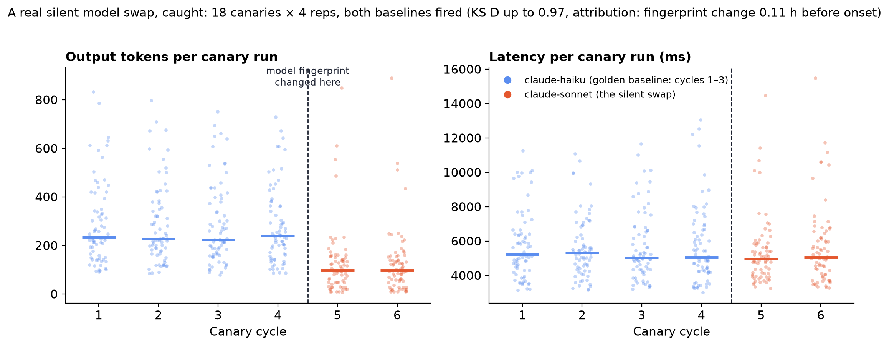

# Demonstration workflow: a silent model swap

This page shows the workflow for a scripted silent model swap that you can
regenerate end to end with four commands. The older exact alert count and
semantic-displacement values were produced before the 0.5.1 reference-only
semantic correction and are retracted; run the commands to obtain results for
the installed build.

## The setup

The synthetic agent (`dedrift sim`) runs a frozen suite of **30 canaries
across six behavioral families** — happy-path, edge-case, refusal-boundary,
tool-heavy JSON tasks, adversarial injections, long-context — at **7
repetitions per cycle** (210 records per cycle). Tier-2 semantic signatures
use the zero-dependency pinned hash embedder.

```bash
dedrift init
dedrift embedder pin hash
dedrift sim --cycles 8 --change-cycle 7   # scripted swap at the 8th cycle
dedrift baseline set --first 3            # golden = cycles 1–3
```

The scripted swap changes the model identifier from `simmodel@v1` to
`simmodel@v2` — **same prompt, same canaries, same tooling** — with the
engineered regression profile: longer outputs, higher refusal and
format-error rates, a thicker latency tail. The only trace visible to the
system is a changed configuration fingerprint. Nobody told the detector
anything.

## The verdict

```text
$ dedrift check
Current cycle: cycle-0007
Overall: DRIFT DETECTED
Sudden (vs rolling 4 cycles): DRIFT DETECTED
Cumulative (vs golden 3 cycles): DRIFT DETECTED
Alerts: <build-specific; BH-adjusted and observed-effect gated>
```

The regression suite requires this gross swap to fire on both baselines.
Effects are reported on the same scales used by their gates; inspect the
generated report for the current build rather than copying historical values.

!!! note "How these effects are measured — and why MMD is silent here"
    The semantic centroid is fit on reference records alone, so
    displacement is an out-of-sample score, and latency dispersion is the
    robust mean-absolute-deviation ratio the test is computed on, not a
    variance ratio.

    The demo freezes a *three*-cycle golden baseline, and the MMD noise
    floor requires five reference cycles. The floor is therefore
    unavailable here, so MMD is diagnostic-only and cannot alert — that
    fail-closed behavior is deliberate: three pairwise values cannot
    calibrate a materiality floor. Use at least five known-good golden
    cycles or configure an externally justified floor.



That right-hand panel illustrates why the battery tracks dispersion and P95
alongside means: a tail can move while the center stays similar.

## The attribution

Every alerting signature group was correlated with the recorded config
events:

> **adversarial / output_words** — drift onset ≈ cycle `cycle-0007`.
> Nearest preceding config event: model fingerprint change, **0.0 h before
> onset**. Other signature groups shifted in the same window.

Several signature groups co-shifting after a fingerprint change is what a
configuration change can look like, as opposed to a single family decaying
on its own. The report says *"consistent
with"*, never *"caused by"*; that's a design rule. Events that occur after
the estimated onset are never described as preceding it — they are labelled
weak evidence instead.

## Honest imperfections

- With eight cycles of history the Page–Hinkley change-point localizer is
  at the edge of its usable range, and a couple of signature groups
  localize the onset a cycle early; those attributions are labelled as
  weak evidence rather than preceding-onset. The estimate's measured false
  alarm behavior is documented in [Statistics](statistics.md).
- This is a scripted synthetic agent: it demonstrates detection and
  attribution mechanics, not production performance. The design-partner
  program exists to find missed regressions, false alerts, and workflows in
  which this approach is not useful — [contact the project](https://dedrift.ai/#pricing)
  if you can supply that evidence.

## Reproduce it

```bash
pip install dedrift
dedrift init && dedrift embedder pin hash
dedrift sim --cycles 8 --change-cycle 7 && dedrift baseline set --first 3
dedrift check
```

Runs in about a minute on a typical laptop. The installed build's result is
deterministic for the seeded simulation; results may change when the detector
battery changes. `dedrift report` renders the full markdown report and returns
the same nonzero result code when it detects drift.
