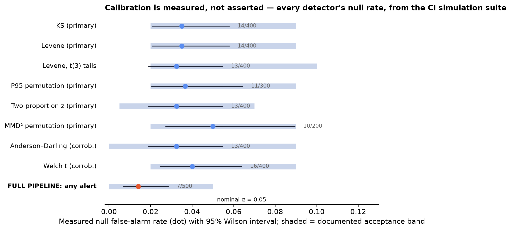

---
hide:
  - navigation
  - toc
---

# dedrift {.dd-visually-hidden style="display:none"}

<div class="dd-hero" markdown>

<h1>A behavioral regression gate<br>for <em>repeatable agent workflows</em>.</h1>

<p class="dd-sub">
dedrift compares repeated frozen-canary runs across agent releases. It combines
multiplicity-adjusted tests, observed-effect gates, and correlational config
context. It is experimental research software, not a production pager.
</p>

[Get started](#try-it-in-two-minutes){ .md-button .md-button--primary }
[The statistics](statistics.md){ .md-button }
[GitHub](https://github.com/dedrift/dedrift){ .md-button }

<div class="dd-pip"><span>$</span> pip install dedrift</div>

<p class="dd-proof-strip">A deliberately large scripted model swap exercises
both baselines in the shipped simulation. That demonstration does not
establish power or detection latency on your agent.
<a href="case-study/">see the demonstration</a>.</p>

</div>

<div class="dd-section-title">A narrower question than observability:<br>did this release change behavior on fixed inputs?</div>
<p class="dd-section-sub">
Model updates, prompt edits, tool-schema changes, RAG refreshes, and
provider-side updates can shift agent behavior without an error in your logs.
</p>

<div class="grid cards" markdown>

-   :material-chart-bell-curve:{ .lg .middle } **Calibrated, not vibes-based**

    ---

    The shipped p-valued detector scenarios have documented simulation bands
    that run in CI and in the release workflow. A failed calibration job blocks
    those workflows; a pass is still not independent validation.

-   :material-filter-check:{ .lg .middle } **Fixed-sample alerts: two gates**

    ---

    The default fixed-sample path applies Benjamini–Hochberg adjustment across
    every primary test, then an observed materiality gate on effect size.
    Statistically significant but practically trivial? It does not become an
    alert row. An alert row is still evidence to investigate, not a page.
    Anytime mode instead uses golden-only e-processes; its tilts target power
    but do not impose this observed-effect gate.

-   :material-bird:{ .lg .middle } **Frozen canaries, N repetitions**

    ---

    Stochastic LLM outputs make single-run comparisons unreliable.
    Canaries run N times per cycle; the fixed-sample path compares
    distributions against a rolling window *and* a frozen golden baseline.
    Anytime mode deliberately uses only the frozen golden reference.

-   :material-source-branch:{ .lg .middle } **Attribution, honestly framed**

    ---

    Every record carries a config fingerprint. When behavior shifts, the
    report correlates onset with the nearest config event — "consistent
    with the model change 5h earlier", never "caused by".

-   :material-laptop:{ .lg .middle } **Runs on a laptop**

    ---

    JSONL logs + SQLite. No servers, no docker-compose, no SaaS account.
    Core installs with zero ML dependencies; embeddings are an optional
    extra with a pinned-forever model.

-   :material-scale-balance:{ .lg .middle } **Honest about power**

    ---

    Small canary suites have limited detection power. The docs show the
    math — including which shifts you *won't* detect at default scale —
    instead of hiding it.

</div>

<div class="dd-section-title">Inspect the controlled demonstration</div>
<p class="dd-section-sub">
A scripted model swap — same prompt and canaries, changed model identity. The
gross-swap regression fires on both baselines and reports the co-located config
fingerprint change as correlational context; exact counts and effects must be
regenerated for the installed build.
</p>

[](case-study.md)

<p style="text-align:center" markdown>
[See the demonstration](case-study.md){ .md-button .md-button--primary }
[Reproduce it yourself](https://github.com/dedrift/dedrift/tree/main/examples){ .md-button }
</p>

<div class="dd-section-title">Measured in a stated simulation, not generalized</div>
<p class="dd-section-sub">
The default detector battery is exercised against documented acceptance bands
by simulation tests in CI. The
full pipeline's null alert rate: 16 of 500 stable-agent checks (3.2%,
Wilson 95% upper bound 5.1%), measured at m ≈ 336 primaries — the
any-alert rate is family-wise and grows with battery size even under
valid per-test FDR, so the headline number is always stated at its
battery size. This is scenario evidence, not a production guarantee. Opt-in
cycle-effect/anytime modes are experimental and require project-specific
calibration; their prior tables are retracted in 0.5.1. Diagnostic flags are
explicitly non-alerting.
</p>

[](statistics.md)

<p style="text-align:center" markdown>
[The statistics, in full](statistics.md){ .md-button }
</p>

## Try it in two minutes

No API keys: the built-in simulator plays an agent whose model version is
swapped mid-history.

```bash
pip install dedrift
mkdir drift-demo && cd drift-demo
dedrift init
dedrift sim --cycles 8 --change-cycle 7
dedrift baseline set cycle-0000 cycle-0001 cycle-0002
dedrift check
```

<div class="dd-terminal">
<span class="p">$</span> dedrift check<br>
Current cycle: cycle-0007<br>
Sudden (vs rolling 4 cycles): <span class="a">DRIFT DETECTED</span><br>
Cumulative (vs golden 3 cycles): <span class="a">DRIFT DETECTED</span><br>
Alerts: multiple (exact rows and values are build-specific)<br>
<span class="c"># dedrift report --out report.md  →  attribution: nearest config event,</span><br>
<span class="c"># model fingerprint change, 0.0 h before onset — consistent with the swap.</span>
</div>

## With your own agent

One function and a YAML file of frozen canary inputs:

```python
# myagent.py
def agent_fn(input: dict) -> dict:
    response = my_agent.run(input["text"])
    return {"text": response.text, "structured": response.json}
```

```bash
dedrift canary run --suite canaries.yaml --agent myagent:agent_fn \
    --model 'anthropic/claude-sonnet-5@2026-05-01'
dedrift report --out report.md
```

`dedrift report` runs the check itself and preserves its exit status: 0 for
supported `OK`, 2 for detected drift, 3 for inconclusive evidence, and 1 for an
operational failure. Do not chain `dedrift check && dedrift report`: a valid
drift result exits 2, so the shell would skip the report. Run this first in CI
or before a release and review the result with task-specific evals. It shows
what measured channel moved, by how much, and which recorded config event was
nearby; it does not establish cause. Full
walkthrough: [quickstart](quickstart.md) ·
[writing canary suites](canaries.md) ·
[configuration](configuration.md).

<div class="dd-section-title">Help test whether the narrow workflow is useful</div>
<p class="dd-section-sub">
We're looking for <strong>design partners</strong> willing to run the
experimental release gate beside their existing evals. Hands-on setup is in
exchange for blunt evidence about false alerts, missed regressions, runtime,
and whether anyone returns to the tool after the first trial.
</p>

<p style="text-align:center" markdown>
[Become a design partner](https://dedrift.ai/#pricing){ .md-button .md-button--primary }
</p>

## Commercial status

There is no hosted service or paid production tier today. Commercialization is
premature until the release-gate workflow shows recurring use and paid intent.
